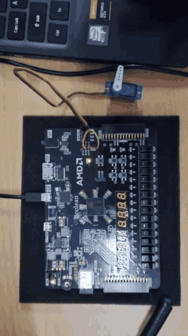
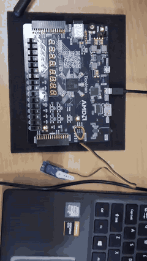
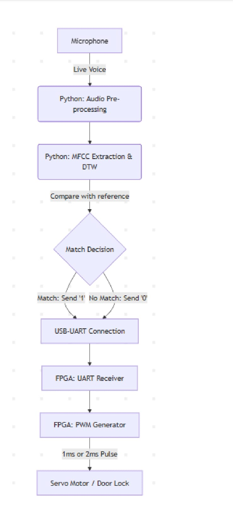
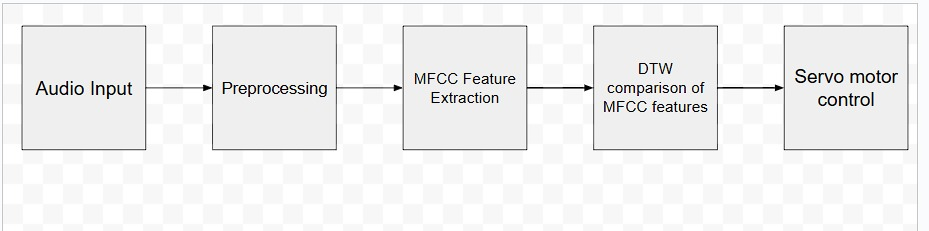
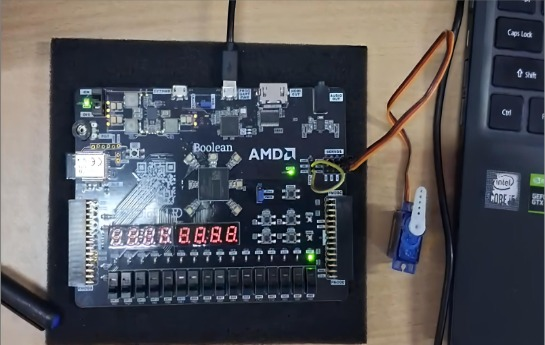

# Audio Authentication and Access Control using FPGA

A voice-activated door lock built with a hardware–software co-design approach. A Python pipeline on the host PC verifies the spoken passphrase using **MFCC** features and **Dynamic Time Warping (DTW)**, and sends the decision over a **9600-baud USB-UART** link to a **Boolean Board (Spartan-7) FPGA**, where Verilog logic receives the command and drives an **SG90 servo** lock with a precise 50 Hz PWM signal.

**Mini Project, B.Tech Electronics & Communication Engineering, Model Engineering College, Thrikkakara (2026)**
**Author:** Harikrishnan TN

## Demo

| Demo 1 | Demo 2 |
|:---:|:---:|
|  |  |

Full videos: [demo_1.mp4](demo/demo_1.mp4) · [demo_2.mp4](demo/demo_2.mp4)

## How it works

1. A USB microphone records a 3-second sample of the passphrase **"Open the door"** at 16 kHz.
2. The audio is trimmed (silence removal, `top_db=20`) and volume-normalised.
3. 13 MFCCs are extracted (25 ms window), the first (volume) coefficient is dropped, and the rest are normalised.
4. DTW aligns the live features with the pre-recorded reference and gives a dissimilarity score.
5. If the score is below the threshold **T = 3.8**, the PC sends ASCII `'1'` (unlock); otherwise it sends `'0'` (lock).
6. On the FPGA, a UART receiver (mid-bit sampling) decodes the byte, and the PWM generator sets the servo pulse:
   - `'0'` → **1 ms** pulse → locked (0°)
   - `'1'` → **2 ms** pulse → unlocked (90°), and the debug LED turns on

### System architecture



### Block diagram



### DTW recursion

```
D(i, j) = d(x_i, y_j) + min{ D(i-1, j), D(i, j-1), D(i-1, j-1) }
```

Mel scale: `Mel(f) = 2595 · log10(1 + f/700)`

## Hardware



| Component | Function | Interface |
|---|---|---|
| Boolean Board FPGA (Spartan-7, 100 MHz) | UART receiver & PWM generator | PROG/UART |
| SG90 servo motor | Physical lock | PWM (AR0) |
| USB lapel microphone | Audio input | USB (host PC) |

**Wiring:** servo signal (orange) → AR0 (D0) pin · servo power (red) → 5V header · servo ground → GND. The servo PWM pin is mapped to package pin **T14** (LVCMOS33) in the constraints file.

**Cost of peripherals:** SG90 servo ₹150 + USB microphone ₹500 = **₹650** (Boolean Board ≈ ₹15,000)

## Repository structure

```
python/
  voice_auth.py        MFCC + DTW verification and serial command to FPGA
  requirements.txt
rtl/
  voice.v              UART receiver (9600 baud) + 50 Hz servo PWM generator
images/           architecture, block diagram, hardware setup
demo/                  demo videos and GIFs
```

| Module / function | Language | Runs on | Purpose |
|---|---|---|---|
| `extract_features()` | Python | Host PC | Computes the MFCC array |
| `librosa.sequence.dtw()` | Python | Host PC | Aligns (warps) the two sequences |
| `ser.write()` (pyserial) | Python | Host PC | Sends ASCII `'1'` / `'0'` |
| `voice.v` | Verilog | FPGA | UART receive + 50 Hz PWM servo control |

## Running it

**FPGA**
1. Create a Vivado project for the Boolean Board and add `rtl/voice.v`.
2. Add your constraints (`clk`, `rx_serial` on the PROG/UART RX pin, `servo` on T14, `led_check` on an LED).
3. Generate the bitstream and program the board using Hardware Manager.

**Host PC**
```bash
cd python
pip install -r requirements.txt
python voice_auth.py
```
- Record your reference passphrase as `rtm.wav` (16 kHz) in the same folder.
- Set `FPGA_PORT` to your board's COM port (for example `COM4`).
- Press Enter and say **"Open the door"**.

## Results

- 50 live tests in total: 20 by the authorised speaker at different speeds and tones, and 30 by other speakers saying the same phrase.
- Authorised speaker scores ranged from **2.5 to 3.6**; other speakers scored **above 4.5**.
- With **T = 3.8**, there were **zero false acceptances**.
- End-to-end latency (end of recording → servo movement) was about **400 ms**.
- The FPGA-generated PWM held the servo steady at 0° (locked) and moved it smoothly to 90° (unlocked), with no jitter.

## Limitations and future scope

- It can't tell a live voice from a high-quality recording (replay attack). Planned fix: **liveness detection**.
- Extreme noise such as heavy wind affects accuracy. Planned fix: **pitch (F0) tracking** as a second check.
- It needs a tethered PC. Planned fix: move the DSP to an embedded SoC (for example a Zynq-based board) and talk to the PWM logic over AXI, making it fully standalone.
